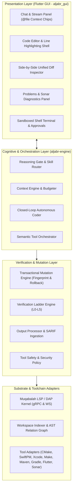
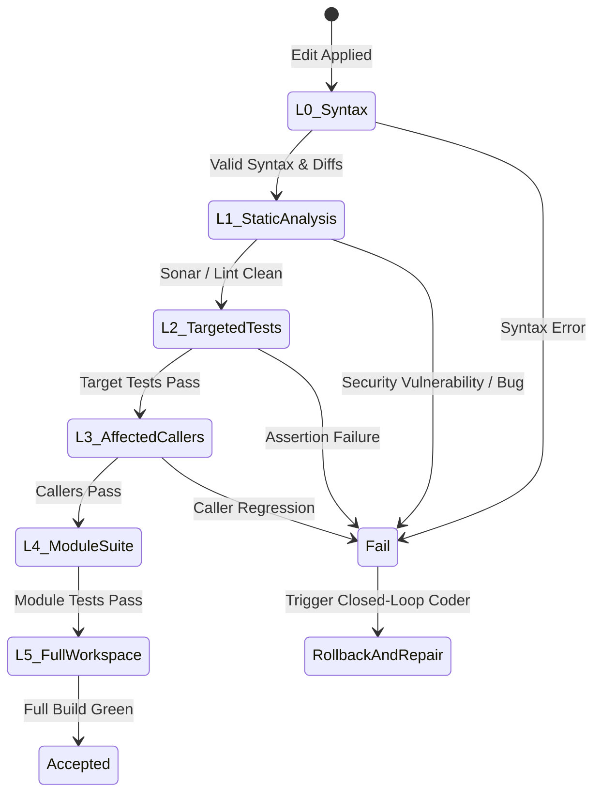
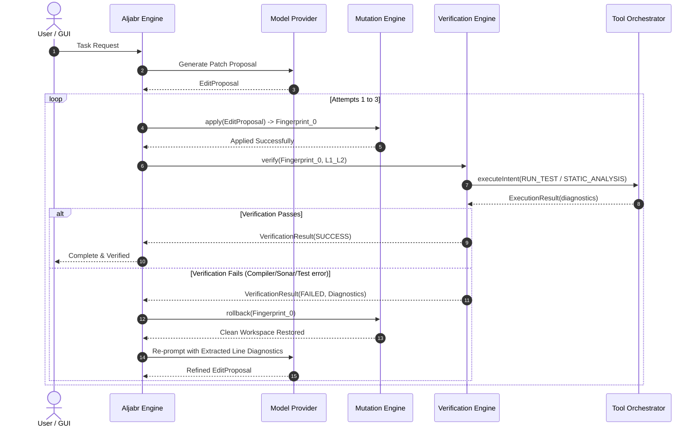
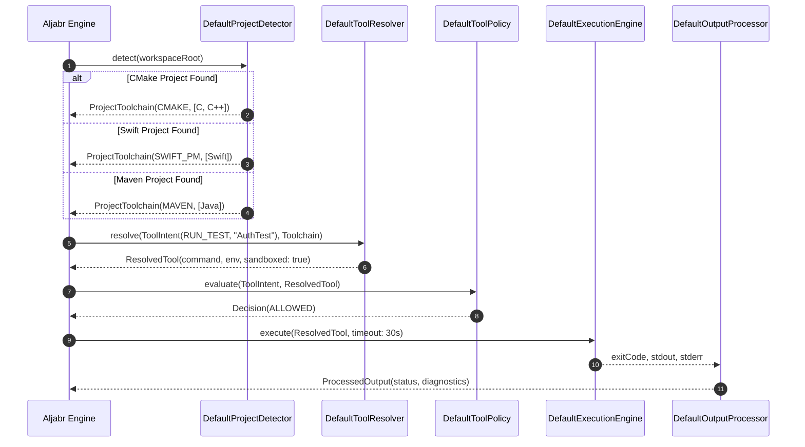
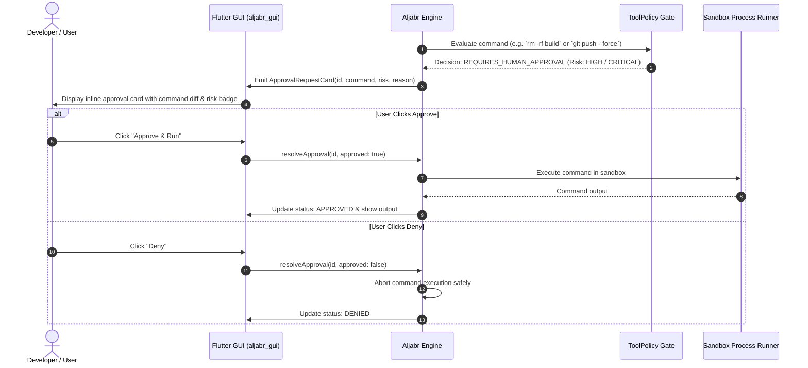
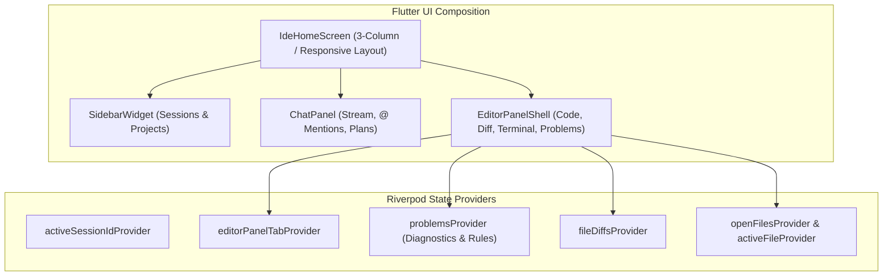

# Aljabr (الجبر) Architectural Specification & Reference Guide

> **Document Version**: 1.0.0  
> **Platform Target**: Java 25 / Quarkus 3.x / Flutter 3.x / SmallRye Mutiny Reactive  
> **Platform Standard**: Local-First Autonomous Software Engineering Substrate  

---

## 1. System Vision & Foundational Tenets

Aljabr is designed to provide an **autonomous, local-first software development platform** that operates with rigorous engineering guarantees. Rather than treating LLMs as naive text generators, Aljabr embeds models within a **deterministic cybernetic control loop**:

$$\text{Task} \xrightarrow{\text{Reasoning Gate}} \text{Context Assembly} \xrightarrow{\text{Model Inference}} \text{Transactional Mutation} \xrightarrow{\text{Verification Ladder}} \text{Closed-Loop Self-Repair}$$

### Core Tenets
1. **Idealism over Pragmatism**: Build future-proof, unified abstractions rather than ad-hoc scripts for single languages.
2. **Deterministic Quality Gates**: Every patch must pass graduated syntax, static analysis (Sonar/SARIF), and targeted test verifications before acceptance.
3. **Budget-Constrained Context Optimization**: Models have finite attention budgets; context is assembled using information-theoretic relevance scoring.
4. **Local-First & Air-Gapped Security**: All indexing, tool resolution, compilation, and linting execute locally in confined process sandboxes.
5. **Ergonomic Synthesis**: Seamlessly unite the fast cursor/diff-editing flow of Codex/Cursor, the autonomous multi-step planning and verification ladder of Google Antigravity, and the command safety and deterministic execution of Claude Code.

---

## 2. Component Building Block Architecture (C4 Layering)

---

## 3. Subsystem Breakdown & Technical Specifications

### 3.1 Reasoning Gate & Adaptive Skill Routing
- **Interface**: [`ReasoningGate`](file:///Users/bhangun/Workspace/workkayys/Products/Wayang/wayang-platform/Wayang-Projects/Wayang-Agents/Aljabr/Backend/aljabr-engine/src/main/java/tech/kayys/aljabr/engine/skill/routing/ReasoningGate.java)
- **Decision Space**:
  - `DIRECT_EXECUTION`: Task has zero ambiguity; invokes a direct tool immediately (e.g. running a specific test or formatting a file).
  - `SINGLE_STEP_REASONING`: Task requires localized reasoning, single patch and verification cycle.
  - `MULTI_STEP_PLANNING`: Complex multi-file refactoring, architectural modifications requiring structured task tracking with user review points.
- **Components**: [`SkillSelector`](file:///Users/bhangun/Workspace/workkayys/Products/Wayang/wayang-platform/Wayang-Projects/Wayang-Agents/Aljabr/Backend/aljabr-engine/src/main/java/tech/kayys/aljabr/engine/skill/routing/SkillSelector.java), [`SkillTelemetryCollector`](file:///Users/bhangun/Workspace/workkayys/Products/Wayang/wayang-platform/Wayang-Projects/Wayang-Agents/Aljabr/Backend/aljabr-engine/src/main/java/tech/kayys/aljabr/engine/skill/telemetry/SkillTelemetryCollector.java)

---

### 3.2 Context Engine & Budget Planning
- **Interface**: [`ContextEngine`](file:///Users/bhangun/Workspace/workkayys/Products/Wayang/wayang-platform/Wayang-Projects/Wayang-Agents/Aljabr/Backend/aljabr-engine/src/main/java/tech/kayys/aljabr/engine/context/DefaultContextEngine.java)
- **Assembly Pipeline**:
  1. **Active Target File**: Primary file under edit with surrounding context.
  2. **Targeted AST Symbol Definitions**: Precise class, method, struct, and function declarations.
  3. **Call Hierarchy & Graph Relations**: Upstream callers and downstream dependencies from `RelationIndex`.
  4. **Build Definitions**: Root build files (`pom.xml`, `CMakeLists.txt`, `Package.swift`, `pubspec.yaml`).
  5. **Failure Traces & Diagnostic Logs**: Precise compiler errors, Sonar rule violations, and test assertion failures from previous iterations.
- **Token Pruning**: [`ContextBudgeter`](file:///Users/bhangun/Workspace/workkayys/Products/Wayang/wayang-platform/Wayang-Projects/Wayang-Agents/Aljabr/Backend/aljabr-engine/src/main/java/tech/kayys/aljabr/engine/context/ContextBudgeter.java) enforces strict byte/token ceilings, truncating lower-priority sections first.

---

### 3.3 Transactional Mutation Engine
- **Interface**: [`MutationEngine`](file:///Users/bhangun/Workspace/workkayys/Products/Wayang/wayang-platform/Wayang-Projects/Wayang-Agents/Aljabr/Backend/aljabr-engine/src/main/java/tech/kayys/aljabr/engine/patch/mutation/MutationEngine.java)
- **Atomic Checkpointing**: Generates `WorkspaceFingerprint` capturing file SHA-256 hashes prior to applying any patch.
- **Rollback Guarantee**: If any verification level in the ladder fails, `MutationEngine.rollback(fingerprint)` restores the workspace to its exact pre-mutation state before feeding diagnostics back to the LLM.

---

### 3.4 Graduated Verification Ladder (L0 to L5)
- **Interface**: [`VerificationEngine`](file:///Users/bhangun/Workspace/workkayys/Products/Wayang/wayang-platform/Wayang-Projects/Wayang-Agents/Aljabr/Backend/aljabr-engine/src/main/java/tech/kayys/aljabr/engine/verification/DefaultVerificationEngine.java)

- **Verification Levels**:
  - `SYNTAX_L0`: Fast AST syntax and patch applicability check.
  - `LINT_L1`: Sonar static analysis, SARIF security scan, formatting compliance.
  - `TARGETED_TESTS_L2`: Tests directly covering modified symbols/files.
  - `AFFECTED_CALLERS_L3`: Tests for upstream callers in the symbol graph.
  - `MODULE_TESTS_L4`: Whole module test suite.
  - `WORKSPACE_FULL_L5`: Complete integration and end-to-end suite.

---

### 3.5 Semantic Tool Orchestrator
- **Interface**: [`ToolOrchestrator`](file:///Users/bhangun/Workspace/workkayys/Products/Wayang/wayang-platform/Wayang-Projects/Wayang-Agents/Aljabr/Backend/aljabr-engine/src/main/java/tech/kayys/aljabr/engine/orchestrator/ToolOrchestrator.java)
- **Lifecycle**:
  $$\text{ToolIntent} \xrightarrow{\text{ProjectDetector}} \text{ProjectToolchain} \xrightarrow{\text{ToolResolver}} \text{ResolvedTool} \xrightarrow{\text{ToolPolicy}} \text{ExecutionEngine} \xrightarrow{\text{OutputProcessor}} \text{ProcessedOutput}$$

#### Supported Toolchain Adapters:
- **`CMakeToolAdapter`**: Builds via `cmake --build build`, tests via `ctest`, formats via `clang-format`.
- **`MakeToolAdapter`**: Builds via `make` / `meson compile`, tests via `make test`.
- **`SwiftPmToolAdapter`**: Builds via `swift build`, tests via `swift test --filter`, formats via `swift-format`.
- **`XcodeToolAdapter`**: Builds via `xcodebuild build`, tests via `xcodebuild test`, formats Objective-C/Swift.
- **`MavenToolAdapter`**: Builds via `mvn compile`, tests via `mvn test -Dtest=...`.
- **`GradleToolAdapter`**: Builds via `./gradlew assemble`, tests via `./gradlew test --tests ...`.
- **`FlutterToolAdapter`**: Builds via `flutter build`, tests via `flutter test`.
- **`SonarToolAdapter`**: Runs `sonar-scanner -Dsonar.sarif.output=sonar-report.sarif`.

---

### 3.6 Sonar & SARIF Static Analysis Quality Gate
- **Parser**: [`SarifReportParser`](file:///Users/bhangun/Workspace/workkayys/Products/Wayang/wayang-platform/Wayang-Projects/Wayang-Agents/Aljabr/Backend/aljabr-engine/src/main/java/tech/kayys/aljabr/engine/orchestrator/output/SarifReportParser.java)
- **Standard**: OASIS SARIF v2.1.0 (Static Analysis Results Interchange Format).
- **Diagnostics Extracted**: Rule ID (e.g. `java:S2259`, `CWE-89`), exact file path, line number, column, severity, and category (`SECURITY`, `BUG`, `CODE_SMELL`).
- **Closed-Loop Feedback**: Feeds exact line-level failure diagnostics back into the `ContextEngine` prompt to enable local LLMs to perform targeted self-healing.

---

## 4. End-to-End Sequence Diagrams

### 4.1 Closed-Loop Autonomous Repair Loop

---

### 4.2 Multi-Language Tool Resolution & Sandboxing

---

### 4.3 Human-in-the-Loop Approval & Interactive Security Gate

---

## 5. UI/UX Architecture (`aljabr_gui`)

The Flutter client architecture is structured using **Riverpod** without codegen, ensuring high performance, low latency, and zero build boilerplate:

### Key UI Features
1. **Problems / Diagnostics View**: Live list of Sonar, compiler, and linter issues with error counters, filter chips, and line-jump links.
2. **Context Pinning**: `@` mentions in chat input for `@file`, `@symbol`, `@git`, `@docs`.
3. **Plan Card**: Antigravity-style checklist showing verification level badges (`L2 Verified`) and step progress.
4. **Execution Console**: Monospace tool execution cards with toolchain tags (`[CMAKE]`, `[SWIFT]`, `[SONAR]`, `[MVN]`) and instant copy actions.
5. **Interactive Approval Cards**: High-risk operations require explicit human confirmation with risk rating badges and reasons.

---

## 6. Verification & Test Suite Matrix

| Component / Subsystem | Test Class | Verification Focus | Status |
| :--- | :--- | :--- | :--- |
| **Reasoning Gate** | `ReasoningGateTest.java` | Complexity evaluation, single vs multi-step plan routing | ✅ 100% Passing |
| **Context Planner** | `ContextEngineTest.java` | Token budgeting, symbol slicing, relation assembly | ✅ 100% Passing |
| **Mutation Engine** | `MutationEngineTest.java` | Atomic edits, AST replacements, fingerprint rollback | ✅ 100% Passing |
| **Verification Ladder** | `VerificationEngineTest.java` | L0 through L5 graduation, targeted test execution | ✅ 100% Passing |
| **Closed-Loop Repair** | `ClosedLoopCoderTest.java` | Diagnostic extraction, rollback & re-prompt loop | ✅ 100% Passing |
| **Tool Orchestrator** | `ToolOrchestratorTest.java` | Toolchain auto-detection, intent mapping, sandboxing | ✅ 100% Passing |
| **SARIF Parser** | `SarifReportParserTest.java` | OASIS SARIF v2.1.0 JSON parsing, line diagnostics | ✅ 100% Passing |
| **Flutter GUI** | `flutter test` (10 tests) | Widgets, Riverpod providers, approval cards, tabs | ✅ 100% Passing |
| **Quarkus Dev Server** | `mvn quarkus:dev` | JVM boot, gRPC (9000), HTTP (8085), live coding | ✅ UP & Verified |
